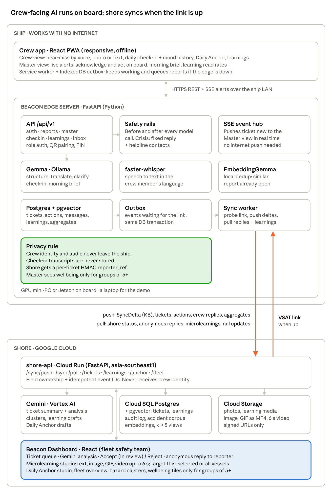

# BigYellow Beacon

**Offline-first AI copilot for seafarer safety and wellbeing.** Google Cloud AI Builder Cup 2026 · Bigyellowfish (BYF).

A seafarer with no internet reports a hazard by voice in Hindi. **Gemma** on the ship's edge server turns it into a structured report and alerts the Master within a second. When the satellite link returns, a ~2 KB delta reaches **Cloud Run**, where **Gemini on Vertex AI** links it to the same hazard on sister vessels and to a past accident, a reviewer replies anonymously, and a 6-second microlearning goes back to the fleet.



## Google AI and Google Cloud in Beacon
| Product | Where | Role |
|---|---|---|
| Gemma 3n (Ollama) | Ship edge | Structure + translate reports, clarifying question, check-in, morning brief, offline |
| EmbeddingGemma | Ship edge | "Similar report already open" |
| Gemini on Vertex AI | Shore | Ticket analysis, microlearning drafts, fleet context, Daily Anchor |
| Vertex AI embeddings | Shore | Similar tickets across the fleet, accident-corpus match |
| Cloud Run | Shore | shore-api + Beacon Dashboard |
| Cloud SQL for PostgreSQL + pgvector | Shore | Tickets, learnings, vectors |
| Cloud Storage | Shore | Photos and learning media (signed URLs) |

## Privacy by design
Crew identity, audio and check-in transcripts never leave the ship. Shore sees a per-ticket HMAC pseudonym, rank band and vessel. Wellbeing numbers appear only for groups of 5 or more. Free text is scrubbed before sync. The contract rejects any sync payload that carries a crew identifier.

## Repo
| Folder | What | Owner |
|---|---|---|
| `contract/` | `beacon_contract` Pydantic package: every payload, enums, HMAC, privacy helpers, demo fixtures (frozen v1.0) | Basil |
| `edge/` | FastAPI edge server, SSE, outbox + sync worker; `edge/app/ai`, `edge/app/safety` for Gemma + rails | Basil / Sumit |
| `shore/` | shore-api on Cloud Run; `shore/app/ai` for Gemini | Engineer 4 / Sumit |
| `web/apps/crew` | React PWA for Crew + Master (served by the edge) | Amar |
| `web/apps/dashboard` | Beacon Dashboard (served by shore-api) | Engineer 4 |
| `seed/` | Synthetic vessels, roster, shore tickets, accident corpus, Daily Anchor pack | |
| `docs/` | `TECHNICAL_DESIGN.md` (source of truth), `DECISIONS.md`, `PLAN.md` | Kundan / Basil |
| `.cursor/rules/` | AI coding rules per role: `00` shared, `10` edge, `20` shore, `30` web, `40` AI | |

## Quick start
```bash
python3 -m venv .venv && source .venv/bin/activate
pip install -e "contract[dev]" && pytest -q contract/tests      # contract must be green
python -m beacon_contract.export                                  # schemas + fixtures for web mocks

cd edge && docker compose up -d db && pip install -e ../contract -e ".[dev]" && make seed
uvicorn app.main:app --port 8080                                  # HTTPS setup: .cursor/rules/30-web.mdc §1
```
Demo logins and IDs: `.cursor/rules/00-beacon-shared.mdc` (Demo data) and `seed/crew_v-0007.json`.

## Working in Cursor
Open this folder (repo root). In Agent chat, mention your rule file and a milestone from it:
```
@10-edge.mdc Build milestone M0 exactly as specified. Show the diff summary, run the tests, list any # DECISION.
@40-ai.mdc   Build milestone A1 (model test matrix) and commit MODELS.md with the results.
@30-web.mdc  Build milestones W0 and W1 for apps/crew.
@20-shore.mdc Build milestone S1, then give me the gcloud commands you used.
```
One milestone per chat. `git pull` before, `git add . && git commit && git pull && git push` after. Don't change `contract/` without telling the team.
