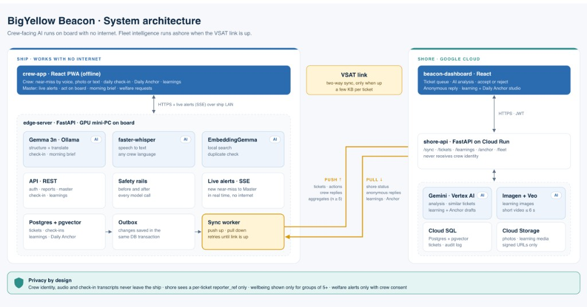

# BigYellow Beacon

**An offline-first AI copilot for seafarer safety and wellbeing.**
Gemma runs on the ship. Gemini runs on shore. Report it once, protect the whole fleet.

Built by Bigyellowfish Technologies (Bengaluru) for the Google Cloud AI Builder Cup 2026. All crew, vessel, and incident data in this repository is synthetic.

## Architecture

Crew-facing AI runs on the ship with no internet. Fleet review runs ashore, and the two sides exchange a few kilobytes only when the VSAT link is up.



| Place | What runs there |
|---|---|
| Ship | `client/crew-app` (React PWA) talks to `server/edge` (FastAPI) over the ship LAN. On board: Gemma 3n via Ollama, faster-whisper, EmbeddingGemma, a REST API, safety checks before and after each model call, and live alerts over SSE. |
| Link | The edge sync worker pushes tickets, actions, and wellbeing aggregates (groups of 5 or more). It pulls shore status, anonymous replies, and learnings. |
| Shore | `client/dashboard` (React) talks to `server/shore` (FastAPI, aimed at Cloud Run). Analysis uses Gemini on Vertex AI, with Ollama as the local option. Photos and short learning media go to Cloud Storage. |

Privacy by design: crew identity, audio, and check-in transcripts stay on the ship. Shore sees a per-ticket reporter reference only. Wellbeing numbers appear only for groups of 5 or more. A welfare alert goes to the Master only with the crew member's consent.

## Repository

```
bigyellow-beacon/
├── client/
│   ├── crew-app/           # Crew + Master PWA
│   └── dashboard/          # Shore dashboard
├── server/
│   ├── edge/               # Ship API. Own contract copy in server/edge/contract/
│   └── shore/              # Shore API. Own contract copy in server/shore/contract/
├── docs/                   # Architecture diagram
├── etc/
└── README.md
```

There is no shared installable contract package and no checked-in OpenAPI files. Each server exposes its own spec at `/docs` when it is running. `docs/` and `etc/` do not hold a design log or deployment pack yet.

## Run it locally

Python 3.12 and Node.js with npm. [Ollama](https://ollama.com) is optional. If Postgres from `.env.example` is not running, each server falls back to a local SQLite file and creates tables on startup. There is no Docker Compose file and no Alembic migration to run.

**Edge** (http://127.0.0.1:8000/docs)

```bash
cd server/edge
cp .env.example .env
python -m venv .venv && source .venv/bin/activate
pip install -r requirements.txt
python scripts/seed_edge_db.py
uvicorn main:app --host 0.0.0.0 --port 8000 --reload
```

**Shore** (http://127.0.0.1:8001/docs)

```bash
cd server/shore
cp .env.example .env
python -m venv .venv && source .venv/bin/activate
pip install -r requirements.txt
python scripts/seed_shore_db.py
uvicorn main:app --host 0.0.0.0 --port 8001 --reload
```

Shore AI is selected with `SHORE_AI_BACKEND` (`auto` by default): Ollama first, then Vertex or Gemini if configured, otherwise a labeled deterministic fallback. The edge server has no `BEACON_AI` switch. It calls Ollama using `OLLAMA_HOST` and the model names in `server/edge/.env.example`, and it still answers with offline fallbacks if Ollama is down.

Models, when you want live AI:

```bash
ollama pull gemma3n:e4b
ollama pull gemma3n:e2b
ollama pull gemma3:4b
ollama pull embeddinggemma
```

**Frontends**

```bash
cd client/crew-app && npm install && npm run dev
cd client/dashboard && npm install && npm run dev
```

Seeded sign-in, from the seed scripts:

| Who | Sign-in |
|---|---|
| Ship | Vessel `MV-PACIFIC-STAR`. Pairing code `BEACON`. Master PIN `123456`. Crew PIN `1234`. |
| Shore | `reviewer@beacon.maritime` / `ShoreReviewer2026!` or `admin@beacon.maritime` / `ShoreAdmin2026!` |

API errors are a flat `{"error": "..."}`. Do not expect `{"error": {"code", "message"}}`.

## Tests

```bash
cd server/edge && pytest -q tests/     # 21 tests
cd server/shore && pytest -q tests/    # 9 tests
cd client/crew-app && npm test
cd client/dashboard && npm test
```

## Who uses it

| Role | App | What they do |
|---|---|---|
| Crew | `client/crew-app` | Report a hazard by voice, photo, or text. Follow the ticket. Private daily check-in. |
| Master | Same app, Master view | Live alert, act on board, morning brief, sync panel. |
| Fleet safety team | `client/dashboard` | Queue, analysis, accept or reject, anonymous reply, learning and Daily Anchor studio. |

Live prototypes (mock data): [crew and Master](https://beacon-crew-talk.lovable.app) · [dashboard](https://beacon-crew-hub.lovable.app).

Service notes: [edge](server/edge/README.md) · [shore](server/shore/README.md) · [crew app](client/crew-app/README.md) · [dashboard](client/dashboard/README.md).
