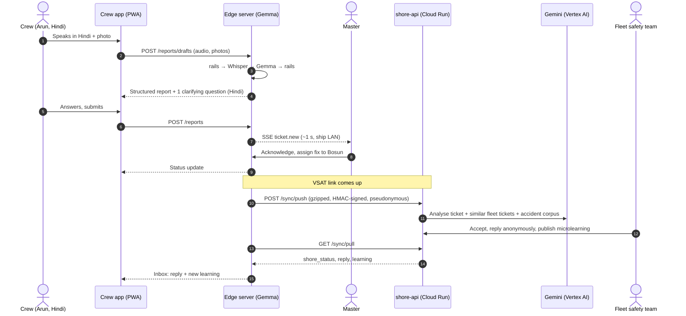
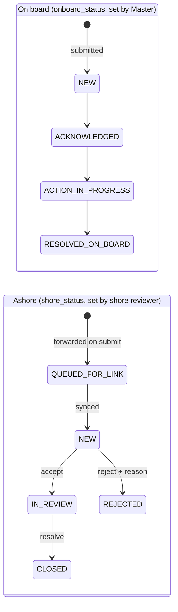

# BigYellow Beacon

**An offline-first AI copilot for seafarer safety and wellbeing.**
Gemma runs on the ship · Gemini runs on shore · *Report it once, protect the whole fleet.*

> Built by Bigyellowfish Technologies (Bengaluru) for the **Google Cloud AI Builder Cup 2026** (Hack2skill, JAPAC).
> Theme: Sustainability & Social Impact. All crew, vessel and incident data in this repository is **synthetic**.

---

## Contents

1. [The problem](#1-the-problem)
2. [What Beacon does](#2-what-beacon-does)
3. [Who uses it](#3-who-uses-it)
4. [Features](#4-features)
5. [Architecture](#5-architecture)
6. [How a report flows](#6-how-a-report-flows)
7. [Ticket lifecycle](#7-ticket-lifecycle)
8. [AI design](#8-ai-design)
9. [Privacy and security](#9-privacy-and-security)
10. [Offline and sync design](#10-offline-and-sync-design)
11. [Tech stack](#11-tech-stack)
12. [Repository structure](#12-repository-structure)
13. [API overview](#13-api-overview)
14. [Getting started (local)](#14-getting-started-local)
15. [Deployment on Google Cloud](#15-deployment-on-google-cloud)
16. [Testing](#16-testing)
17. [Demo scenario](#17-demo-scenario)
18. [Project status and roadmap](#18-project-status-and-roadmap)
19. [Team](#19-team)
20. [Contributing rules](#20-contributing-rules)

---

## 1. The problem

About **90% of world trade** moves by sea, carried by about **1.9 million seafarers** (ICS; BIMCO/ICS Seafarer Workforce Report 2021). They work contracts that last months, often with little or no internet.

- **Near-misses go unreported.** Reporting usually means an English form, filled in after a long shift, with a name on it. So the same hydraulic leak waits on a sister ship until someone gets hurt.
- **Wellbeing suffers in silence.** In a Yale University and ITF Seafarers' Trust study (2019), **1 in 4 seafarers** showed symptoms of depression. Periodic surveys arrive weeks late, if at all.
- **The signal exists but never reaches anyone who could act.** BYF's analysis of **250+ accident investigations** found that 6–7 recurring causes are behind roughly **80%** of cases.

Today's tools assume the cloud, assume English, and put a name on every report. None of these hold at sea.

## 2. What Beacon does

Beacon puts the AI **on the ship**, so it works with no internet, and uses **Google Cloud** ashore to turn one ship's near-miss into a lesson for the whole fleet.

| | On the ship (offline) | Ashore (Google Cloud) |
|---|---|---|
| **Where** | Beacon edge server on the ship LAN | Cloud Run, Cloud SQL, Cloud Storage |
| **AI** | Gemma 3n / Gemma 3 (vision), EmbeddingGemma, faster-whisper | Gemini and embeddings on Vertex AI |
| **Job** | Turn a voice, photo or text report in any language into a structured, ISM-coded safety report; alert the Master; private daily check-in | Match reports across sister vessels and past accidents; review, reply anonymously, publish microlearnings to the fleet |
| **Data** | Everything, including identity (stays on board) | Pseudonymous, structured tickets and aggregates only |

The two sides talk through **KB-sized, signed sync deltas** whenever the satellite (VSAT) link is up.

## 3. Who uses it

| Role | App | What they get |
|---|---|---|
| **Crew** | Crew app (web app on their phone, served by the ship's edge server) | Report a hazard in 20–30 s by voice, photo or text in their own language; follow their reports; anonymous thread with shore; private 60-second daily check-in and mood history; Daily Anchor and microlearnings |
| **Master / Safety Officer** | Same web app, Master view | Live alerts within about a second; acknowledge, assign and resolve on board; AI morning brief; crew wellbeing trend (groups of 5+ only); sync panel |
| **Fleet safety team (shore)** | Beacon Dashboard | Fleet ticket queue; Gemini analysis; accept or reject; anonymous reply to the reporter; microlearning studio; fleet overview and hazard clusters |

There is no native mobile app. Crew and Master use the **same React PWA**, served by the edge server over the ship's Wi-Fi.

## 4. Features

### Crew app (crew view)
- **Report a near-miss** by voice (≤60 s), photos (≤3) or text, in any language.
- **AI structuring on board:** title and description in English, location, hazard type (12 types), ISM category (6), severity 1–5 with a rubric, original-language transcript.
- **One clarifying question**, asked in the crew member's language, only when something important is missing.
- **Duplicate hint:** "A similar report is already open" (EmbeddingGemma, local vector search).
- **Anonymous by default.** The reporter can opt in to share their name with the Master for one report; shore never sees it.
- **My reports** with both statuses: on-board (Master) and shore review.
- **Inbox:** shore and Master replies, status changes, new learnings.
- **Daily check-in (60 s):** quick mood/sleep/fatigue or a short chat. Private mood history (7/30/90 days) that only the user can see. Conversations are never stored.
- **Daily Anchor:** a short daily card in the user's language.
- **Microlearnings:** short lessons with an image, GIF or ≤6 s clip and one check question.

### Crew app (Master view)
- **Live alerts** (server-sent events) for new tickets, with sound and vibration.
- **Kanban board** by on-board status: New → Acknowledged → Action in progress → Resolved on board.
- **Actions** with a responsible rank and due date.
- **AI morning brief:** open hazards, crew mood trend (k ≥ 5), one recommended action.
- **Device pairing** with a QR code and PIN.
- **Sync panel:** link up/down, pending items, last push size; demo toggle to simulate the link.
- **Learning stats** and **welfare requests** (only after the crew member consents).

### Beacon Dashboard (shore)
- **Ticket queue** across the fleet with filters (vessel, severity, hazard, ISM, status, date, search).
- **Ticket detail** with no crew identity, only rank band and a per-ticket pseudonym.
- **Gemini analysis:** summary, similar tickets on sister vessels, matches against the accident-investigation corpus, recommended actions.
- **Accept (→ In review) / Reject (with reason) / Close**, flowing back to the ship.
- **Anonymous reply** to the reporter, in any shore state.
- **Microlearning studio:** Gemini drafts the text from a ticket; attach an image, GIF or ≤6 s video; target one, several or all vessels; publish.
- **Fleet overview and hazard clusters**; wellbeing tiles only for groups of 5+.
- **Daily Anchor studio:** Gemini drafts a week of cards; review, translate, schedule.

## 5. Architecture


**Key design rules**
- **Crew-facing AI runs on board.** A report never waits for a satellite link.
- **Field ownership:** the edge owns `onboard_status` and the report fields; shore owns `shore_status`. No last-writer-wins across owners.
- **Idempotency everywhere:** every write from the phone carries an `Idempotency-Key`; every sync event has a UUIDv7 `event_id` that shore records in `processed_events`.
- **One shared contract:** every payload between crew app, edge, shore and dashboard is defined once as Pydantic models (`beacon_contract`, v1.0). OpenAPI specs, JSON Schemas, TypeScript types and demo fixtures are generated from it.
- **AI gateway seam:** `BEACON_AI=fake|ollama` on the edge and `SHORE_AI=fake|vertex` on shore, so UI and backend work can proceed without the models.

## 6. How a report flows



## 7. Ticket lifecycle

Two independent status tracks: the **Master owns on board**, **shore owns review**.



Every ticket is forwarded to shore automatically; the Master cannot block it. Anonymous replies can be sent in any shore state. Ticket numbers look like `BCN-0007-0012` (vessel 0007, ticket 12).

## 8. AI design

| Task | Where | Model |
|---|---|---|
| Speech to text in the crew member's language | Edge | faster-whisper (small, multilingual) |
| Structure + translate a report, ask one clarifying question | Edge | Gemma 3n (E2B/E4B) via Ollama |
| Photo understanding | Edge | Gemma 3 4B (vision) if Gemma 3n image input is not available under Ollama |
| Similar-report search and dedup | Edge | EmbeddingGemma + pgvector |
| Check-in conversation and scoring | Edge | Gemma 3n |
| Master morning brief | Edge | Gemma 3n |
| Ticket analysis, sister-vessel and accident-corpus matching | Shore | Gemini on Vertex AI (structured output) |
| Hazard clustering and labels | Shore | Vertex AI embeddings + Gemini |
| Microlearning and Daily Anchor drafts | Shore | Gemini on Vertex AI |

**Prompt rules:** structured JSON output validated against the contract's `*LLMOutput` models; no invented facts; unknown fields stay `null`; the model never sees crew names.

**Safety rails (deterministic):** keyword and pattern rules (`lexicon.json` in the edge server's safety module) run **before and after every model call**. Crisis language returns a fixed, pre-written response with helpline contacts and offers the crew member the option to ask the Master to check on them. The model never improvises in a crisis. Fixed responses are marked as placeholders until a clinician signs them off. Rail hits are counted on the edge only and are never synced.

## 9. Privacy and security

| Rule | How it is enforced |
|---|---|
| Crew identity never leaves the ship | Shore receives `reporter_ref = "rr_" + HMAC-SHA256(vessel_secret, crew_id:ticket_id)[:32]`, a different pseudonym for every ticket, plus a collapsed rank band |
| Audio never leaves the ship | Audio is deleted when the reporter confirms the draft; the contract rejects any `audio` key in a sync delta |
| Check-in conversations are never stored | Only scores are kept, on the edge |
| Wellbeing only in groups | `K_ANON = 5`: Master and shore see mood trends only for groups of 5 or more |
| Forbidden keys cannot sync | `SyncEvent` validation rejects names, PINs, transcripts, audio and shore-owned fields |
| Free text is scrubbed | `scrub_text` removes names and identifiers before sync |
| Signed sync | Headers `X-Vessel-Id`, `X-Timestamp`, `X-Signature = HMAC-SHA256(api_key, METHOD\nPATH\nTS\nsha256(body))`, ±300 s window |
| Auth | Crew/Master: QR pairing → device token → PIN (4 digits crew, 6 Master) → 12 h JWT; 5 wrong PINs lock the device. Shore: email + password, 1 h access + 8 h refresh JWT |
| Secrets | `.env` files and keys are never committed; Secret Manager on Google Cloud |
| Media | Photos and learning media in Cloud Storage, served only through short-lived signed URLs |

## 10. Offline and sync design

**Phone → edge.** The crew app is a PWA with a service worker. Every write goes to a Dexie (IndexedDB) outbox first, with an `Idempotency-Key` created when the action is made, so retries never duplicate. If the edge is briefly unreachable, the app keeps working and flushes later. Live updates use server-sent events (`@microsoft/fetch-event-source`). Mic and camera need HTTPS, so the edge serves TLS on the ship LAN (mkcert locally, Caddy on the VM).

**Edge → shore.**
1. Every state change writes an outbox event **in the same database transaction**.
2. The sync worker probes `GET /healthz` on shore. When the link is up it pushes a gzipped `SyncDelta` (≤500 events or 256 KB; a typical report is under 1 KB).
3. Photos upload separately, only after their ticket is acknowledged, so text always lands first.
4. It pulls shore changes with a cursor: `ticket.shore_status`, shore messages, `learning.published/retracted`, `fleet_alert`, `rail_update`, `anchor.scheduled`, `brief_enrichment`.
5. Shore records every `event_id`; duplicates are acknowledged without being reapplied.

**Demo link simulation:** `POST /sync/override {mode: auto|up|down}` toggles the link from the Master view.

## 11. Tech stack

| Layer | Technology |
|---|---|
| Edge AI | Gemma 3n (E2B/E4B), Gemma 3 4B (vision), EmbeddingGemma, Ollama, faster-whisper |
| Edge backend | Python 3.12, FastAPI, SQLAlchemy (async) + Alembic, PostgreSQL 16 + pgvector, Docker Compose |
| Shore backend | Python 3.12, FastAPI on **Cloud Run**, **Cloud SQL** for PostgreSQL + pgvector, **Cloud Storage**, **Secret Manager**, `google-genai` with **Gemini on Vertex AI** |
| Frontends | React + Vite + TypeScript, PWA (service worker, Dexie outbox), server-sent events, openapi-typescript / openapi-fetch; UI prototypes in Lovable |
| Contract | Pydantic v2 models → OpenAPI, JSON Schema, TypeScript types, fixtures |
| Security | JWT, QR pairing + PIN, HMAC-signed sync, per-ticket pseudonyms, k-anonymity |
| Infra (demo) | Compute Engine VM as the simulated ship edge server (e2-standard-8, Ubuntu 24.04, 100 GB, static IP; GPU optional), Caddy for HTTPS |

## 12. Repository structure

```
bigyellow-beacon/
├── client/                 # Frontends
│   ├── edge/               # Crew app: crew view + Master view (React PWA, served by the edge server)
│   └── shore/              # Beacon Dashboard for the fleet safety team (React)
├── server/                 # Backends
│   ├── edge/               # Beacon edge server: FastAPI + Postgres/pgvector + Ollama (Gemma) + Whisper
│   └── shore/              # shore-api: FastAPI on Cloud Run + Cloud SQL + Vertex AI (Gemini)
├── docs/                   # Technical design, decisions log, plan, frontend API guide, diagrams
├── etc/                    # Shared configuration and deployment files
├── .gitignore
└── README.md
```

Put folder-specific setup notes in a README inside each of the four app folders.

## 13. API overview

Full specs are generated from the contract (`edge.openapi.json`: 38 paths, `shore.openapi.json`: 30 paths). Highlights:

**Edge API** (`https://<edge-host>/api/v1`, Bearer JWT)

| Area | Endpoints |
|---|---|
| Auth | `POST /auth/pairing-codes` (Master), `POST /auth/pair`, `POST /auth/login`, `DELETE /auth/devices/{id}`, `GET /me` |
| Reports | `POST /reports/drafts`, `POST /reports/drafts/{id}/structure`, `POST /reports/drafts/{id}/answer`, `POST /reports`, `GET /reports/mine` |
| Threads & inbox | `GET/POST /tickets/{id}/messages`, `GET /inbox`, `POST /inbox/{id}/read` |
| Master | `GET /master/tickets`, `POST /master/tickets/{id}/ack`, `POST /master/tickets/{id}/actions`, `GET /master/brief`, `GET /master/learnings/stats`, `GET /master/welfare` |
| Wellbeing | `POST /checkins`, `POST /checkins/{id}/turn`, `POST /checkins/{id}/welfare-request`, `GET /checkins/history` |
| Content | `GET /anchor/today`, `GET /learnings`, `POST /learnings/{id}/ack` |
| Live & sync | `GET /events` (SSE), `GET /sync/status`, `POST /sync/now`, `POST /sync/override`, `GET /healthz` |

**Shore API** (`https://shore-api-<hash>.a.run.app/api/v1`)

| Area | Endpoints |
|---|---|
| Sync (vessel HMAC) | `GET /healthz`, `POST /sync/push`, `GET /sync/pull?cursor=`, `POST /sync/media/{id}`, `GET /sync/media-url/{id}` |
| Dashboard auth | `POST /auth/login`, `POST /auth/refresh`, `POST /auth/logout` |
| Tickets | `GET /tickets`, `GET /tickets/{id}`, `GET/POST /tickets/{id}/analysis`, `POST /tickets/{id}/accept`, `/reject`, `/close`, `GET/POST /tickets/{id}/messages`, `GET /tickets/{id}/similar` |
| Learnings | `POST /learnings/draft`, `POST /learnings`, `PATCH /learnings/{id}`, `POST /learnings/{id}/media`, `/publish`, `/retract`, `GET /learnings` |
| Fleet & Anchor | `GET /fleet/overview`, `GET /fleet/clusters`, `GET /vessels`, `/anchor/*` |

Errors always look like `{"error": {"code", "message", "retry_after?"}}`.

**SSE events:** `ticket.new`, `ticket.updated`, `message.new`, `learning.new`, `sync.status`, `brief.updated`, `anchor.new`, `checkin.reminder`, `welfare.request`.

## 14. Getting started (local)

### Prerequisites
- Python 3.12, Node.js 20+ and pnpm, Docker
- [Ollama](https://ollama.com) for the Gemma models
- `mkcert` for local HTTPS (mic and camera need a secure origin)

### 1. Pull the models
```bash
ollama pull gemma3n:e2b
ollama pull gemma3n:e4b
ollama pull gemma3:4b
ollama pull embeddinggemma
```

### 2. Edge server
```bash
cd server/edge
cp .env.example .env
docker compose up -d db
python -m venv .venv && source .venv/bin/activate
pip install -e ".[dev]"
alembic upgrade head
make seed
make pair-master
make run
```
- Postgres runs in Docker on host port **5433**.
- Set `BEACON_AI=fake` to work without models, or `BEACON_AI=ollama` to use Gemma.
- Quote any `.env` value that contains spaces. Never commit `.env`.

### 3. Shore API
```bash
cd server/shore
cp .env.example .env
python -m venv .venv && source .venv/bin/activate
pip install -e ".[dev]"
alembic upgrade head
make run
```
`SHORE_AI=fake` returns contract fixtures; `SHORE_AI=vertex` calls Gemini (needs Google Cloud credentials).

### 4. Frontends
```bash
cd client/edge && pnpm install && pnpm dev
cd client/shore && pnpm install && pnpm dev
```
Without a backend, run a mock server from the generated OpenAPI spec, e.g. `npx @stoplight/prism-cli@5.12.0 mock -p 4010 edge.openapi.json`, and point the Vite proxy at it.

### Demo accounts (synthetic)
Vessel `v-0007` *MV Demo Star* with 14 synthetic crew. The Master is `c-0007-mst`; the Hindi-speaking reporter is `c-0007-aru`. Demo PINs are set in the seed files; change them for any shared deployment.

## 15. Deployment on Google Cloud

**Simulated ship edge server (Compute Engine)**
- VM: e2-standard-8 (8 vCPU, 32 GB) in `asia-south1` (Mumbai), Ubuntu 24.04 LTS, 100 GB balanced disk, static external IP. Add a T4/L4 GPU later if CPU latency is too high.
- Install Docker and Ollama, pull the models, run the edge server with Docker Compose.
- HTTPS with Caddy and a `sslip.io` hostname so phones can use the mic and camera.
- Open only 80/443 (and 22 for your IP).

**Shore (`asia-southeast1`)**
- `shore-api` container on **Cloud Run** (service account with Cloud SQL Client, Storage Object Admin on the bucket, Vertex AI User, Secret Accessor).
- **Cloud SQL** for PostgreSQL 16 with the `vector` extension.
- **Cloud Storage** bucket for photos and learning media (private; signed URLs only).
- **Secret Manager** for the JWT secret, database password and vessel API keys.
- Beacon Dashboard served as static files (Cloud Run or Cloud Storage + CDN).

Approximate demo cost: about US$0.32/hour for the edge VM (stop it when idle); Cloud Run, Cloud SQL (small instance) and Cloud Storage cost a few tens of dollars a month; Gemini analysis is a few dollars per 1,000 tickets.

## 16. Testing

```bash
pytest -q
```
- **Contract:** 58 tests covering field ownership, forbidden sync keys, k-anonymity, signing and fixtures.
- **Edge server:** 47 tests across milestones M0–M5 (auth and pairing, reports and structuring, Master view and SSE, messages and inbox, sync status, learnings).
- **Planned:** extraction accuracy eval on a labelled near-miss set; Gemma latency on CPU vs GPU; end-to-end sync tests against Cloud Run.

## 17. Demo scenario

1. **Arun**, an able seaman on *MV Demo Star*, says in Hindi: *"क्रेन के पास हाइड्रोलिक लीक पर मैं फिर से फिसलते-फिसलते बचा।"* ("I nearly slipped on the hydraulic leak near the crane, again.")
2. Gemma, on board, returns a structured report: *Slipped on hydraulic leak near deck crane*, slip/trip/fall, unsafe condition, severity 3. It asks in Hindi which crane and which side of the deck.
3. The **Master** is alerted within about a second, acknowledges, and assigns the bosun to isolate crane 2 and clean the deck. Arun sees the update.
4. The satellite link comes up. The ship sends **less than 1 KB**: no names, no audio, no conversations.
5. Ashore, **Gemini** finds the same crane leak on *MV Sister One* and *MV Sister Two*, and a past accident where a slip at a crane pedestal ended in a fractured wrist.
6. The safety team **accepts** the ticket, **replies anonymously** to Arun, and publishes a **microlearning** with a 6-second clip to every vessel.
7. On the next sync, the reply and the lesson reach the crew.

Demo video: _add link_ · Live UI prototypes: [crew + Master app](https://beacon-crew-talk.lovable.app) · [Beacon Dashboard](https://beacon-crew-hub.lovable.app) (mock data).

## 18. Project status and roadmap

| Area | Status |
|---|---|
| Shared contract v1.0 (models, OpenAPI, TS types, fixtures) | ✅ Done |
| Edge server M0–M5 | ✅ Done (47 tests) |
| Edge M6 (check-in, brief, Anchor) and M7 (sync worker, Ollama gateway hardening) | ✅ Done |
| Shore API S1–S6 on Cloud Run | ✅ Done |
| Crew app and Beacon Dashboard (Lovable prototypes with mock data) | ✅ Done |
| Gemma latency benchmark on the GCP edge VM | ✅ Done |

**Next:** pilot on 2–3 vessels with a GPU mini-PC on board; fine-tune Gemma 3n on maritime near-miss language; add Tagalog, Bahasa, Ukrainian and Burmese UI strings; integrate with existing SMS/PMS near-miss modules; fleet-wide leading indicators; rest-hour and fatigue signals in the morning brief.

**Pilot hypotheses we will measure:** 3–5× more near-miss reports per vessel within 90 days; 70%+ daily check-in participation (vs 20–30% for periodic surveys); same-day on-board action on reported hazards; fewer repeat incidents across sister vessels.

## 19. Team

BigYellow Beacon is built by a team from Bigyellowfish Technologies, Bengaluru, for the Google Cloud AI Builder Cup 2026.

| Name |
|---|
| Kundan Krishna |
| Basil Chacko Mathew |
| Sumit Ujjwal |
| Amarjeet Ray |

---

<p align="center">
  <b>BigYellow Beacon</b> · Gemma on the ship, Gemini on shore<br/>
  <i>Report it once. Protect the whole fleet.</i> ⚓
</p>

---

*Sources for statistics: International Chamber of Shipping; BIMCO/ICS Seafarer Workforce Report 2021; Yale University & ITF Seafarers' Trust (2019); BYF internal analysis of accident investigations.*
