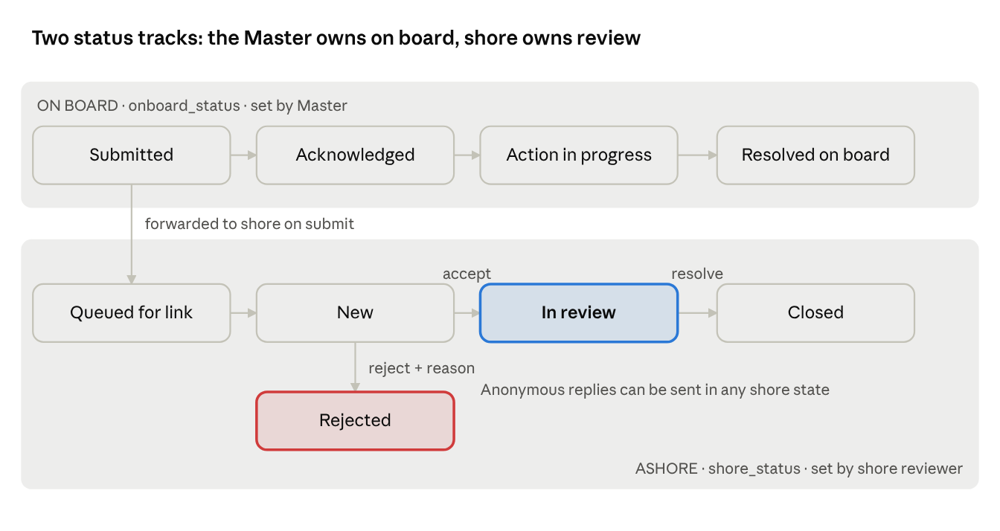

# BigYellow Beacon POC: Technical Design

Oct 17, 2026 · @Kundan Krishna

## 1. Overview and POC scope

Beacon is a three-tier system: an offline React crew app on the ship
LAN, a Python edge server on board running Gemma locally, and a shore
tier on Google Cloud running Gemini on Vertex AI behind the Beacon
Dashboard. The POC proves one loop end to end: a crew member reports a
near-miss with no internet, the Master is alerted and acts on board
within seconds, the ticket reaches shore when the link returns, shore
reviews it with AI analysis, replies anonymously to the reporter, and
pushes a microlearning back to one or all vessels.

**In scope for the POC**

- Crew app (React, responsive, offline-first PWA) with role-based views
  for Crew and Master

- Near-miss capture by voice, photo or text, structured locally by Gemma

- Real-time Master alerts on board, Master acknowledge and on-board
  action

- Edge to shore delta sync over an intermittent link (simulated by
  toggling Wi-Fi)

- Beacon Dashboard: ticket queue, Gemini summary and analysis, Accept
  (In Review) or Reject, anonymous reply to originator

- Microlearning authoring (text, image, GIF, video up to 6 seconds),
  AI-assisted drafting, targeting to same vessel, selected vessels or
  all vessels, with on-board notification and read receipts

- Daily wellbeing check-in with a private mood history for each crew
  member, plus Daily Anchor: one short motivational, safety or
  maritime-news card every day

**Out of scope for the POC**

- Native mobile apps, on-phone model inference

- Real VSAT integration (the link is simulated)

- Production identity provider, MDM, multi-tenant billing

- Real crew data (synthetic crew and vessels only)

## 2. Reference architecture (edited)

The original reference architecture holds: the edge server owns every
crew interaction and the model server runs fully offline. The POC
version merges the crew app and ship dashboard into one React PWA, adds
an SSE hub for instant Master alerts, and moves shore storage to Cloud
SQL so both tiers share one schema.

BigYellow Beacon POC architecture · ship, VSAT link, shore

Read top to bottom: the crew app only talks to the edge, the edge only
talks to shore through the sync worker, and the Beacon Dashboard only
talks to shore-api. Section 3 lists each change from the original
diagram.

## 3. Changes from the original reference architecture

The reference diagram is about 80% reusable. The edge server, model
server, outbox and sync worker stay as drawn. Seven changes are needed
to match today's requirements.

| \#  | Reference                                      | POC version                                                                                       | Why                                                                    |
|-----|------------------------------------------------|---------------------------------------------------------------------------------------------------|------------------------------------------------------------------------|
| 1   | Android crew app + separate Ship dashboard     | One React PWA served by the edge, role-based views for Crew and Master                            | One codebase, works on any phone or laptop on the ship LAN             |
| 2   | Crew app queues if edge is down                | Same, via service worker + IndexedDB outbox in the browser                                        | Two offline layers: phone to edge, edge to shore                       |
| 3   | No on-board ticket flow                        | Master alert stream (SSE), acknowledge, on-board action, forward to shore                         | New requirement: Master acts immediately                               |
| 4   | Shore: Firestore + Firebase Auth               | Cloud SQL Postgres + pgvector, JWT auth in shore-api                                              | Same schema and SQLAlchemy models on edge and shore; 4 people, one day |
| 5   | Shore dashboard: fleet views + escalations     | Beacon Dashboard: ticket queue, Accept/Reject, AI analysis, anonymous reply, microlearning studio | New requirement                                                        |
| 6   | Sync pull: fleet alerts, brief, rail updates   | Pull also carries ticket status changes, shore replies, microlearnings and media                  | Shore to ship return path                                              |
| 7   | Psychology team escalations in shore dashboard | Removed. Crew get a daily check-in with mood history; shore gets a Daily Anchor content studio    | No psychologist role in the POC                                        |

Everything else from the deck (Gemma on edge, Gemini on Vertex AI, Cloud
Run, Cloud Storage, k ≥ 5 rule, transcripts never stored) is retained.

## 4. Tech stack

| Layer                    | Choice                                                                                                                                                      | Notes                                                          |
|--------------------------|-------------------------------------------------------------------------------------------------------------------------------------------------------------|----------------------------------------------------------------|
| Crew app (Crew + Master) | React 18 + Vite + TypeScript, Tailwind, vite-plugin-pwa (Workbox), Dexie (IndexedDB), React Router                                                          | Responsive, installable PWA, served by the edge over HTTPS     |
| Beacon Dashboard (shore) | React 18 + Vite + TypeScript, same UI kit as crew app                                                                                                       | Hosted on Firebase Hosting or as static files on Cloud Run     |
| Edge API                 | Python 3.11, FastAPI, Uvicorn, SQLAlchemy 2 + Alembic, Pydantic v2                                                                                          | Single process plus a sync worker task                         |
| Edge DB                  | PostgreSQL 16 + pgvector (Docker)                                                                                                                           | SQLite is an acceptable fallback for the demo laptop           |
| Edge models              | Gemma 3n E4B (or Gemma 3 4B for image input) via Ollama; faster-whisper (small, multilingual) for speech-to-text; EmbeddingGemma for local search and dedup | All offline; pin model tags before the demo                    |
| Edge media               | ffmpeg / ffprobe, Pillow                                                                                                                                    | Photo resize, audio normalise, video duration check            |
| Shore API                | Python 3.11, FastAPI on Cloud Run (asia-southeast1)                                                                                                         | Same Pydantic sync contract package as edge                    |
| Shore DB                 | Cloud SQL for PostgreSQL + pgvector                                                                                                                         | Tickets, learnings, accident corpus embeddings                 |
| Shore AI                 | Gemini (Vertex AI, google-genai SDK) with structured JSON output; Vertex text embeddings                                                                    | Summary, analysis, similar-ticket search, microlearning drafts |
| Shore media              | Cloud Storage, signed URLs                                                                                                                                  | Photos, learning media                                         |
| Shared                   | beacon-contract Python package (Pydantic models), generated TypeScript types via openapi-typescript                                                         | One source of truth for payloads                               |
| Dev / deploy             | Docker Compose for edge, gcloud run deploy for shore, mkcert for local HTTPS                                                                                |                                                                |

## 5. Roles and permissions

Identity never leaves the ship. Shore roles see vessel, rank band and
content, never a crew member's name or ID.

| Role                               | Where                 | Login                                       | Can do                                                                                                                                                              | Cannot see                                                                                                |
|------------------------------------|-----------------------|---------------------------------------------|---------------------------------------------------------------------------------------------------------------------------------------------------------------------|-----------------------------------------------------------------------------------------------------------|
| Crew                               | Crew app              | QR pairing + 4-digit PIN                    | Daily check-in and own mood history, read Daily Anchor, report near-miss, view own reports and status, read anonymous shore replies, view and acknowledge learnings | Other crew's reports or identity                                                                          |
| Master (incl. Safety Officer)      | Crew app, Master view | QR pairing + 6-digit PIN                    | Real-time alerts, acknowledge, add on-board action, set on-board status, forward to shore, morning brief, learnings read rates                                      | Reporter identity when reporter chose anonymous (default); individual check-in scores (groups of 5+ only) |
| Shore Reviewer (fleet safety team) | Beacon Dashboard      | Email + password (JWT)                      | Ticket queue, AI analysis, accept or reject, anonymous reply, create and publish microlearnings, schedule Daily Anchor cards                                        | Any crew identity, raw audio, transcripts                                                                 |
| Shore Admin                        | Beacon Dashboard      | Email + password (JWT)                      | Everything a reviewer can, plus vessels, users, device tokens                                                                                                       | Same as reviewer                                                                                          |
| Edge device (vessel)               | Sync API              | Per-vessel API key + HMAC request signature | Push deltas, pull updates, fetch media                                                                                                                              | Anything for other vessels                                                                                |

## 6. Crew app features (Crew + Master)

One React PWA, served from the edge at https://beacon.ship.local. The
role in the session token decides which navigation tabs render. Layout
is mobile-first (360 px), with a two-column Master layout from 1024 px.

### 6.1 Common

- **Pairing**: scan a QR shown by the Master view (encodes edge URL +
  one-time pairing code), set PIN. Device token stored in IndexedDB.

- **Language**: UI strings in English, Hindi, Tagalog, Bahasa,
  Ukrainian, Chinese (i18next). Crew content is captured in any language
  and translated by Gemma on the edge.

- **Connectivity banner**: three states, Edge connected, Edge
  unreachable, saving on this phone, Ship offline from shore, last sync
  HH:MM (from /sync/status).

- **Inbox**: anonymous shore replies, ticket status changes, new
  learnings. Unread badge.

- **Offline**: app shell cached by service worker; every write goes to
  the Dexie outbox first and is flushed to the edge on reconnect (online
  event, app focus, 15 s retry).

### 6.2 Crew features

1.  **Report a near-miss** (target: under 30 seconds)

    - Inputs: hold-to-record voice (max 60 s, MediaRecorder, webm/opus),
      up to 3 photos (resized on device to 1280 px, JPEG q70), optional
      text.

    - Edge returns a structured draft: title, location on board, hazard
      type, ISM category, severity (1 to 5), immediate action taken,
      English translation. Gemma may return one clarifying question.

    - Crew edits the draft, picks Anonymous (default) or Share my name
      with Master, submits.

    - Fallback if the edge is unreachable: the raw capture is queued on
      the phone and structured when it reaches the edge.

2.  **My reports**: list with status chips (Submitted, Acknowledged by
    Master, Action taken, Sent to shore, In review, Rejected, Closed)
    and the anonymous reply thread for each.

3.  **Daily check-in and Daily Anchor**: once-a-day wellbeing check-in
    with a private mood history (6.4), and today's Daily Anchor card on
    the home screen (6.5).

4.  **Learnings**: card feed of microlearnings for this vessel. Each
    card shows text, image, GIF or 6-second video, Do and Don't lists,
    and an I understood button.

### 6.3 Master features

1.  **Live alerts**: Server-Sent Events stream from the edge. New
    near-miss triggers an in-app banner, sound and vibration
    (navigator.vibrate), plus an OS notification via the service worker
    when the tab is backgrounded. No internet push service is used.

2.  **Near-miss board**: Kanban by on-board status (New, Acknowledged,
    Action in progress, Resolved on board) with severity colour and age.

3.  **Ticket actions**: Acknowledge, add on-board action (free text +
    responsible rank + due time), attach photo of the fix, mark resolved
    on board, Forward to shore (on by default for severity 3 and above,
    automatic for every ticket in the POC).

4.  **Reply to reporter** on board (same anonymous thread, labelled
    Master).

5.  **Morning brief**: one page generated by Gemma on the edge from open
    hazards, check-in group trend (k ≥ 5), and the last 24 h of tickets,
    with one recommended action. Refreshed when shore enrichments
    arrive.

6.  **Learnings status**: per learning, percentage of crew who
    acknowledged (counts only).

7.  **Crew pairing**: show pairing QR, revoke a device.

8.  **Welfare alerts**: consented requests from a crew member's check-in
    (6.4). Shows name and time only, with Acknowledge and Mark
    contacted. Never shows check-in text or scores.

### 6.4 Daily wellbeing check-in and mood history

Every crew member gets one check-in per day and a private view of their
own mood over time. Nobody else sees an individual's entries.

- **When**: one per crew member per ship day. Reminder at a time the
  crew member picks (default 18:00 ship time) via SSE toast and inbox
  item; can be done any time that day.

- **Two modes**:

  - Quick (10 s, no AI): mood face (1 to 5), hours slept, fatigue
    slider, optional tags (rest, workload, home, family, health, team).

  - Chat (under 60 s): mood face, then 2 to 3 short Gemma turns by voice
    or text in their language. Gemma scores mood, fatigue and workload 1
    to 5. Transcript is discarded after scoring.

- **After submitting**: one supportive line and one practical tip from
  Gemma (rest, hydration, talk to a shipmate), checked by the safety
  rails.

- **My mood history** (crew only): 7 / 30 / 90-day line chart of mood
  and fatigue, calendar heatmap by mood colour, check-in streak, most
  frequent tags, and one plain-language pattern from Gemma (for example
  "your mood is lower on days with under 6 hours of sleep"). Computed on
  the edge, never synced.

- **Control**: crew can delete their history at any time. History is
  kept on the edge for the contract, then deleted on sign-off.

- **Who sees what**: Master sees the vessel trend only when 5 or more
  crew checked in that day; shore sees the same aggregates per vessel.
  No individual score leaves the crew member's view.

- **Crisis language**: safety rails replace the model reply with a fixed
  message listing on-board contacts (Master, medical officer) and the
  24/7 seafarer helpline set by the ship manager. The app then asks
  "Would you like the Master to check on you?". Only on Yes, the Master
  gets a private welfare alert with the crew member's name and no
  check-in content. On No, nothing is shared.

### 6.5 Daily Anchor (daily bytes)

Daily Anchor is one short card a day on the crew home screen, rotating
three kinds: **Motivation** (a short reflection or quote), **Safety** (a
topical tip, often tied to fleet hazard clusters), **Maritime news** (a
2 to 3 line industry update with source name).

- Top of the home screen with a type badge; tap to expand. Past 14 days
  feed below.

- Buttons: Helpful and Save. Saved cards appear under My saved. Only
  counts sync to shore.

- Shown in the crew member's language (pre-translated on shore).

- Content is scheduled 7 days ahead and arrives on any pull, so a ship
  offline for a week still gets a card every day.

- Fallback: the edge ships with a seed pack of 60 evergreen motivation
  and safety cards, used when nothing is scheduled.

- Size budget: text plus one optional image under 200 KB per card.

- Shore authoring is in the Beacon Dashboard (8.5).

## 7. Edge server modules

One FastAPI app (edge/) with these modules. All run on a GPU mini-PC or
Jetson on board; a laptop for the demo.

| Module       | Responsibility                                                                                                                   | Key components                                                                                                    |
|--------------|----------------------------------------------------------------------------------------------------------------------------------|-------------------------------------------------------------------------------------------------------------------|
| auth         | QR pairing, PIN login, session JWT (role, vessel_id, crew_id), device revoke                                                     | argon2 PIN hash, short-lived JWT (12 h)                                                                           |
| reports      | Near-miss intake, media storage, draft structuring, submit, reporter thread                                                      | multipart upload, media saved under /data/media/{uuid}                                                            |
| master       | Board queries, acknowledge, actions, on-board status, forward                                                                    | Emits events to events                                                                                            |
| events       | Server-Sent Events hub, per-role channels (vessel:{id}:master, crew:{id})                                                        | asyncio queues; replays missed events by Last-Event-ID                                                            |
| ai           | Local model gateway: transcribe, structure, translate, clarify, check-in turn, morning brief                                     | Ollama HTTP client, faster-whisper, prompt templates, JSON schema validation with 1 retry                         |
| safety       | Deterministic rails before and after every model call                                                                            | Multilingual keyword and regex lists, fixed clinician-approved responses with helpline contacts, rail-hit counter |
| checkin      | Daily check-in (one per crew per day), scoring, reminders, personal mood history and pattern insight, k-anonymous aggregates     | Transcript held in memory only, never written                                                                     |
| learnings    | Store learnings pulled from shore, serve feed, record acknowledgements                                                           | Media cached locally after pull                                                                                   |
| inbox        | Per-crew messages: shore replies, status changes, learning notices                                                               | Keyed by pseudonymous reporter_ref                                                                                |
| outbox       | Every change that must reach shore is written as an event row in the same DB transaction                                         | Transactional outbox pattern                                                                                      |
| sync         | Background worker: link probe, push outbox batches, pull shore updates, fetch media                                              | gzip JSON, idempotent event IDs, cursor-based pull                                                                |
| admin        | Vessel config, crew roster (synthetic), seed data                                                                                |                                                                                                                   |
| daily_anchor | Store scheduled cards pulled from shore, serve today's card and the 14-day feed, record helpful/save, fall back to the seed pack | Cards keyed by ship-local date                                                                                    |

**Link detection**: the sync worker calls GET {shore}/healthz every 30 s
with a 3 s timeout. Two consecutive successes mark the link UP and
trigger push then pull. A demo override POST /api/v1/sync/now forces a
cycle.

## 8. Beacon Dashboard (shore) features

React web app for the fleet safety team. Polls GET
/tickets?updated_since= every 10 s (simple, demo-safe); SSE from
shore-api is a stretch.

### 8.1 Ticket queue

- Table with filters: status, vessel, severity, hazard type, ISM
  category, date range. Default sort: severity desc, then age.

- Columns: ticket no. (BCN-\<vessel\>-\<seq\>), title (English), vessel,
  severity, hazard type, on-board status, shore status, received at,
  similar-ticket count.

- Badge on tickets where the Master already resolved on board.

### 8.2 Ticket detail

- **Left pane, as reported**: English translation, original language
  text, photos, structured fields, rank band (Officer / Rating / Cadet),
  Master's on-board actions and timeline. No reporter identity.

- **Right pane, AI analysis (Gemini)**, generated on arrival and
  re-runnable: executive summary (3 lines), probable contributing
  factors, ISM category check and suggested correction, severity check,
  similar tickets across the fleet (vector search), matching
  accident-corpus cases with citation, recommended corrective and
  preventive actions, and a Suggested microlearning flag. Every block is
  labelled AI generated with model name and time.

- **Actions**:

  - Accept → status IN_REVIEW, assigns to the current reviewer.

  - Reject → requires a reason from a list (Duplicate, Not a near-miss,
    Insufficient info, Out of scope) plus a note. Reporter is notified.

  - Reply to reporter → anonymous message thread (Section 9).

  - Mark resolved / Close from IN_REVIEW.

  - Create microlearning → opens the studio pre-filled from this ticket.

### 8.3 Microlearning studio

See Section 10.

### 8.4 Fleet overview

- Cards: open tickets by severity, tickets per vessel (last 30 days),
  top hazard types, learnings acknowledgement rate.

- Hazard cluster list: Gemini-labelled clusters of similar tickets
  across sister vessels.

- Wellbeing tiles per vessel, shown only when the group size is 5 or
  more.

### 8.5 Daily Anchor studio

- Calendar view of the next 14 days, one card per day per audience;
  empty days show a warning.

- Draft a week with AI: Gemini drafts 7 cards with a mix of Motivation,
  Safety and News. Safety cards draw on the current fleet hazard
  clusters. News cards are written only from items the editor pastes
  (link or text); Gemini summarises to 2 to 3 lines and keeps the source
  name and URL. No automatic web scraping in the POC.

- Editor reviews, edits, optionally adds one image, sets audience (all
  vessels or selected vessels) and approves. Approval triggers Gemini
  translation into the crew languages.

- Stats per card: vessels delivered, views, helpful, saved.

## 9. Ticket lifecycle and anonymity model

A ticket carries two independent statuses so ship and shore never
overwrite each other: onboard_status is owned by the edge (Master),
shore_status is owned by shore-api. Each side only syncs the field it
owns.

near-miss ticket lifecycle · two status tracks

The Master can resolve on board while shore is still reviewing; the crew
app shows both.

### 9.1 Transitions

| Transition                                             | Actor                            | Where                | Notifies                                    |
|--------------------------------------------------------|----------------------------------|----------------------|---------------------------------------------|
| Draft to Submitted                                     | Crew                             | Crew app to edge     | Master (SSE alert)                          |
| Submitted to Acknowledged                              | Master                           | Crew app             | Reporter inbox                              |
| Acknowledged to Action in progress / Resolved on board | Master                           | Crew app             | Reporter inbox; synced to shore             |
| Submitted to Queued for link                           | System                           | Edge outbox          | Nothing                                     |
| Queued for link to New                                 | Sync worker                      | Shore-api /sync/push | Dashboard queue; Gemini analysis job starts |
| New to In review                                       | Shore reviewer (Accept)          | Dashboard            | Master + reporter on next pull              |
| New to Rejected                                        | Shore reviewer (Reject + reason) | Dashboard            | Master + reporter on next pull, with reason |
| In review to Closed                                    | Shore reviewer                   | Dashboard            | Master + reporter on next pull              |

### 9.2 Anonymity model

- The edge keeps the real reporter_crew_id in its own reports table. It
  never leaves the ship.

- Shore receives reporter_ref = HMAC-SHA256(vessel_secret, crew_id +
  ticket_id). It is unique per ticket, so shore cannot link two reports
  to the same person.

- Shore sees only rank band (Officer, Rating, Cadet) and vessel. If a
  band has fewer than 5 people on that vessel, it is sent as Crew.

- Before push, the edge scrubs free text: crew names from the roster,
  phone numbers, emails and ID-like strings become \[crew\]. Photos have
  EXIF stripped.

- **Anonymous reply**: shore posts to /tickets/{id}/messages. The edge
  pulls it, resolves reporter_ref locally to the crew member, and drops
  it in their inbox. Crew replies travel back the same way. Shore sees
  the sender as Reporter.

- The Master sees the reporter's name only if the reporter opted in for
  that report.

- Near-miss audio stays on the edge and is deleted once the reporter
  confirms the draft. Check-in transcripts are never written to disk.

## 10. Microlearning module

A microlearning is a one-screen lesson about a tool, area or situation,
created from a ticket (or from scratch), targeted to vessels, and
delivered over the same sync pull. Budget per learning: 2 MB total media
so it fits a throttled VSAT link.

### 10.1 Authoring (Beacon Dashboard)

1.  Reviewer clicks Create microlearning on a ticket, or New in the
    Learnings tab.

2.  Draft with AI: Gemini receives the ticket's English text, structured
    fields and AI analysis, and returns title, 2-line context,
    situation, 3 Do points, 3 Don't points, one check question with 3
    options, tags (tool, area, situation) and a suggested audience
    (same_vessel, sister_vessels, all_vessels). No reporter or
    vessel-identifying detail is included.

3.  Reviewer edits every field. AI-drafted fields stay marked until
    edited.

4.  Media (optional, one primary + up to 2 images):

    - Image: JPEG, PNG or WebP, resized server-side to 1280 px, WebP
      output.

    - GIF: accepted, converted to looping muted MP4 (much smaller),
      shown like a GIF.

    - Video: max 6.0 s checked with ffprobe; re-encoded to H.264, 480p,
      no audio track by default, target under 1.5 MB. Longer clips are
      rejected with the measured duration.

    - Optional: reuse the ticket's photo (EXIF-stripped).

5.  Targeting: This vessel (the ticket's vessel), Selected vessels
    (multi-select, filter by vessel type), or All vessels. Optional
    rank-band filter (Officers, Ratings, All).

6.  Priority: Normal (feed only) or Urgent (Master alert + crew
    notification + must acknowledge).

7.  Preview on phone renders the crew card at 360 px. Publish sets
    status PUBLISHED and writes one delivery row per target vessel.

### 10.2 Delivery on board

- On the next pull the edge receives the learning JSON, then fetches
  media through signed URLs. The learning is shown only after all its
  media is cached.

- The edge emits an SSE learning.new event to crew and Master; crew see
  an in-app toast and an inbox item. Urgent learnings also raise a
  Master alert.

- Crew opens the card, plays media inline (muted autoplay, loop for
  GIF-type), answers the check question, taps I understood.

- Acknowledgements are stored per crew on the edge; only counts
  (delivered, opened, acknowledged, check_correct) are synced to shore.

### 10.3 Shore tracking

Learnings table: title, source ticket, audience, published at, vessels
delivered / total, acknowledgement rate. Reviewer can Retract a
learning; the retraction travels on the next pull and hides the card.

## 11. Data model

One SQLAlchemy model package is shared by edge and shore; tables marked
Edge or Shore exist only on that tier. All IDs are UUIDv7 generated
where the record is born, so sync never collides. Every synced table has
created_at, updated_at, origin (edge/shore) and version (int).

| Table              | Tier  | Key columns                                                                                                                                                                                                                                                                                                                                                              |
|--------------------|-------|--------------------------------------------------------------------------------------------------------------------------------------------------------------------------------------------------------------------------------------------------------------------------------------------------------------------------------------------------------------------------|
| vessels            | Both  | id, name, imo, type, fleet_group, api_key_hash, vessel_secret (edge only)                                                                                                                                                                                                                                                                                                |
| crew               | Edge  | id, vessel_id, display_name, rank, rank_band, language, checkin_reminder_at, pin_hash, is_master, active                                                                                                                                                                                                                                                                 |
| devices            | Edge  | id, crew_id, paired_at, last_seen_at, revoked                                                                                                                                                                                                                                                                                                                            |
| shore_users        | Shore | id, email, password_hash, role (reviewer, admin)                                                                                                                                                                                                                                                                                                                         |
| tickets            | Both  | id, ticket_no, vessel_id, reporter_ref, reporter_crew_id (edge only), share_name_with_master, rank_band, title_en, description_en, description_original, original_language, location_on_board, hazard_type, ism_category, severity (1 to 5), immediate_action, occurred_at, onboard_status, shore_status, reject_reason, reject_note, assigned_to, embedding vector(768) |
| ticket_media       | Both  | id, ticket_id, kind (photo, audio), local_path, gcs_uri, sha256, bytes, synced                                                                                                                                                                                                                                                                                           |
| ticket_actions     | Both  | id, ticket_id, actor_role, action_type (ack, action, resolve, note), text, responsible_rank, due_at                                                                                                                                                                                                                                                                      |
| ticket_messages    | Both  | id, ticket_id, sender (reporter, master, shore), shore_user_id (shore only), body, created_at, delivered_at, read_at                                                                                                                                                                                                                                                     |
| ai_analyses        | Shore | id, ticket_id, model, prompt_version, summary, contributing_factors (jsonb), ism_check, severity_check, recommendations (jsonb), similar_ticket_ids, corpus_matches (jsonb), suggest_learning (bool), created_at                                                                                                                                                         |
| accident_corpus    | Shore | id, source (e.g. MAIB), title, url, summary, hazard_type, embedding vector(768)                                                                                                                                                                                                                                                                                          |
| learnings          | Both  | id, source_ticket_id, title, context, situation, do_points (jsonb), dont_points (jsonb), check_question (jsonb), tags, priority, rank_filter, status (draft, published, retracted), ai_drafted_fields, published_at                                                                                                                                                      |
| learning_media     | Both  | id, learning_id, kind (image, gif_mp4, video), gcs_uri, local_path, duration_s, bytes, sha256                                                                                                                                                                                                                                                                            |
| learning_targets   | Shore | learning_id, vessel_id, delivered_at                                                                                                                                                                                                                                                                                                                                     |
| learning_acks      | Edge  | learning_id, crew_id, opened_at, acked_at, check_correct                                                                                                                                                                                                                                                                                                                 |
| learning_stats     | Both  | learning_id, vessel_id, delivered, opened, acknowledged, check_correct                                                                                                                                                                                                                                                                                                   |
| checkins           | Edge  | id, crew_id, ship_date, mode (quick/chat), mood, fatigue, workload, sleep_hours, tags, rail_hit, tip, created_at (unique crew_id + ship_date; no transcript column)                                                                                                                                                                                                      |
| checkin_aggregates | Both  | vessel_id, date, n, mood_avg, fatigue_avg, workload_avg (synced only when n ≥ 5)                                                                                                                                                                                                                                                                                         |
| anchor_cards       | Both  | id, publish_date, type (motivation, safety, news), title (jsonb per language), body (jsonb per language), source_name, source_url, image_uri, audience (all or vessel_ids), status (draft, approved, retracted), ai_drafted, is_seed                                                                                                                                     |
| anchor_reactions   | Edge  | card_id, crew_id, viewed_at, helpful, saved                                                                                                                                                                                                                                                                                                                              |
| anchor_stats       | Both  | card_id, vessel_id, views, helpful, saved (counts only)                                                                                                                                                                                                                                                                                                                  |
| welfare_requests   | Edge  | id, crew_id, created_at, status (open, acknowledged, contacted), acked_at (no check-in content; never synced)                                                                                                                                                                                                                                                            |
| outbox             | Edge  | id (event_id), entity, entity_id, op, payload (jsonb), created_at, pushed_at, attempts                                                                                                                                                                                                                                                                                   |
| sync_state         | Both  | vessel_id, last_pull_cursor, last_push_at, link_status                                                                                                                                                                                                                                                                                                                   |
| inbox              | Edge  | id, crew_id, kind, ref_id, title, read_at                                                                                                                                                                                                                                                                                                                                |

## 12. Edge API

Base: https://beacon.ship.local/api/v1. Auth: Authorization: Bearer
\<session JWT\> except pairing. All writes accept an Idempotency-Key
header (the client-generated UUID) so queued retries from the phone
never duplicate.

| Method     | Path                                      | Role         | Purpose                                                                                                                                  |
|------------|-------------------------------------------|--------------|------------------------------------------------------------------------------------------------------------------------------------------|
| POST       | /auth/pairing-codes                       | Master       | Create one-time pairing code, returns QR payload                                                                                         |
| POST       | /auth/pair                                | Public       | {pairing_code, crew_id} returns device token                                                                                             |
| POST       | /auth/login                               | Device       | {device_token, pin} returns session JWT                                                                                                  |
| DELETE     | /auth/devices/{id}                        | Master       | Revoke device                                                                                                                            |
| GET        | /me                                       | Any          | Profile, role, language, vessel                                                                                                          |
| POST       | /reports/drafts                           | Crew         | Multipart: audio?, photos\[\]?, text?, language? Returns draft_id                                                                        |
| POST       | /reports/drafts/{id}/structure            | Crew         | Runs STT + Gemma; returns structured fields + optional clarifying_question                                                               |
| POST       | /reports/drafts/{id}/answer               | Crew         | {answer} to the clarifying question; returns updated fields                                                                              |
| POST       | /reports                                  | Crew         | {draft_id, fields, share_name_with_master} submits ticket; emits ticket.new                                                              |
| GET        | /reports/mine                             | Crew         | Own tickets with both statuses                                                                                                           |
| GET        | /tickets/{id}/messages                    | Crew, Master | Thread for a ticket (crew: own tickets only)                                                                                             |
| POST       | /tickets/{id}/messages                    | Crew, Master | Reply in thread; queued to shore                                                                                                         |
| GET        | /master/tickets                           | Master       | Board, filters onboard_status, severity                                                                                                  |
| POST       | /master/tickets/{id}/ack                  | Master       | Acknowledge                                                                                                                              |
| POST       | /master/tickets/{id}/actions              | Master       | {text, responsible_rank, due_at, resolve?: bool}                                                                                         |
| GET        | /master/brief                             | Master       | Latest morning brief; POST /master/brief/regenerate to refresh                                                                           |
| GET        | /master/learnings/stats                   | Master       | Ack counts per learning                                                                                                                  |
| POST       | /checkins                                 | Crew         | Start today's check-in with {mode: quick or chat, mood}; quick mode completes here, chat returns first prompt; 409 if already done today |
| POST       | /checkins/{id}/turn                       | Crew         | {text or audio} returns next prompt or final scores; safety rails applied                                                                |
| POST       | /checkins/{id}/welfare-request            | Crew         | {consent: true} after a rail hit; emits SSE welfare.request to Master                                                                    |
| GET / POST | /master/welfare, /master/welfare/{id}/ack | Master       | List open welfare requests; acknowledge or mark contacted                                                                                |
| GET        | /checkins/history?range=7d\|30d\|90d      | Crew         | Own daily entries, streak, top tags, pattern insight (own data only)                                                                     |
| DELETE     | /checkins/history                         | Crew         | Delete own history                                                                                                                       |
| PUT        | /me/preferences                           | Any          | Language, check-in reminder time                                                                                                         |
| GET        | /anchor/today                             | Crew, Master | Today's Daily Anchor card in the user's language (seed pack if none scheduled)                                                           |
| GET        | /anchor?days=14&saved=bool                | Crew, Master | Past cards feed, or saved cards                                                                                                          |
| POST       | /anchor/{id}/react                        | Crew, Master | {viewed?, helpful?, saved?}                                                                                                              |
| GET        | /learnings                                | Crew, Master | Feed for this vessel                                                                                                                     |
| GET        | /learnings/{id}/media/{media_id}          | Crew, Master | Cached media stream (range requests)                                                                                                     |
| POST       | /learnings/{id}/ack                       | Crew         | {opened?, acked?, check_answer?}                                                                                                         |
| GET        | /inbox                                    | Any          | Unread items; POST /inbox/{id}/read                                                                                                      |
| GET        | /events                                   | Any          | SSE stream: ticket.new, ticket.updated, message.new, learning.new, sync.status, brief.updated, anchor.new, checkin.reminder              |
| GET        | /sync/status                              | Any          | \`{link: UP                                                                                                                              |
| POST       | /sync/now                                 | Master       | Force a sync cycle (demo)                                                                                                                |
| GET        | /healthz                                  | Public       | Liveness + model availability                                                                                                            |

**Structure response example**

{  
"draft_id": "0192...",  
"original_language": "hi",  
"transcript_original": "crane ke paas hydraulic leak pe phir se phisal
gaya",  
"fields": {  
"title_en": "Slipped on hydraulic leak near deck crane",  
"description_en": "Reporter nearly slipped on hydraulic oil near the
deck crane. Recurring.",  
"location_on_board": "Main deck, crane no. 2",  
"hazard_type": "slip_trip_fall",  
"ism_category": "unsafe_condition",  
"severity": 3,  
"immediate_action": null  
},  
"clarifying_question": {"en": "Was the leak reported to the engine
room?", "hi": "..."},  
"confidence": 0.82  
}

## 13. Shore API and sync contract

Base: https://shore-api-\<hash\>.a.run.app/api/v1 on Cloud Run
(asia-southeast1). Dashboard routes use a shore-user JWT; sync routes
use vessel API key + HMAC signature.

### 13.1 Sync routes (edge to shore)

| Method | Path                                | Purpose                                                                                             |
|--------|-------------------------------------|-----------------------------------------------------------------------------------------------------|
| GET    | /healthz                            | Link probe                                                                                          |
| POST   | /sync/push                          | Gzipped SyncDelta batch of outbox events; returns per-event ack                                     |
| GET    | /sync/pull?cursor=\<c\>&limit=200   | Shore-originated changes for this vessel since cursor; returns {changes\[\], next_cursor, has_more} |
| POST   | /sync/media/{ticket_media_id}       | Upload one photo (only after its ticket is acked)                                                   |
| GET    | /sync/media-url/{learning_media_id} | Short-lived signed GCS URL for learning media                                                       |

Headers on every sync call: X-Vessel-Id, X-Timestamp, X-Signature =
HMAC-SHA256(api_key, method + path + timestamp + sha256(body)). Requests
older than 5 minutes are rejected.

**SyncDelta (push)**

{  
"vessel_id": "v-0007",  
"batch_id": "0192...",  
"contract_version": "1.0",  
"events": \[  
{"event_id": "0192...", "entity": "ticket", "op": "upsert", "entity_id":
"0192...", "version": 3,  
"owned_fields": {"onboard_status": "ACK", "title_en": "...", "severity":
3, "reporter_ref": "hmac..."}},  
{"event_id": "...", "entity": "ticket_action", "op": "insert",
"payload": {}},  
{"event_id": "...", "entity": "ticket_message", "op": "insert",
"payload": {"sender": "reporter"}},  
{"event_id": "...", "entity": "learning_stats", "op": "upsert",
"payload": {}},  
{"event_id": "...", "entity": "checkin_aggregate", "op": "upsert",
"payload": {"n": 7}},  
{"event_id": "...", "entity": "anchor_stats", "op": "upsert", "payload":
{}}  
\]  
}

**Pull change types**: ticket.shore_status, ticket_message (sender
shore), learning.published, learning.retracted, fleet_alert, rail_update
(new safety keyword lists), anchor.scheduled (next 7 days of Daily
Anchor cards), brief_enrichment (fleet cluster context for the Master
brief).

**Rules**

- Shore stores event_id in a processed_events table; duplicates return
  ack without reapplying.

- Field ownership decides conflicts: edge-owned fields are ignored if
  sent by shore and vice versa. No last-writer-wins across owners.

- Batches: max 500 events or 256 KB gzipped; photos go separately after
  the ticket is acked, so text always lands first.

### 13.2 Dashboard routes

| Method       | Path                                           | Purpose                                                                            |
|--------------|------------------------------------------------|------------------------------------------------------------------------------------|
| POST         | /auth/login                                    | Email + password, returns JWT                                                      |
| GET          | /tickets                                       | List; filters status, vessel_id, severity, hazard_type, from, to, updated_since, q |
| GET          | /tickets/{id}                                  | Detail with media URLs, actions, timeline                                          |
| GET          | /tickets/{id}/analysis                         | Latest Gemini analysis                                                             |
| POST         | /tickets/{id}/analysis                         | Re-run analysis                                                                    |
| POST         | /tickets/{id}/accept                           | NEW to IN_REVIEW, assigns caller                                                   |
| POST         | /tickets/{id}/reject                           | {reason, note} NEW to REJECTED                                                     |
| POST         | /tickets/{id}/close                            | {resolution_note} IN_REVIEW to CLOSED                                              |
| GET / POST   | /tickets/{id}/messages                         | Anonymous thread with reporter                                                     |
| GET          | /tickets/{id}/similar                          | Vector search across fleet + accident corpus                                       |
| POST         | /learnings/draft                               | {ticket_id} returns Gemini draft                                                   |
| POST         | /learnings                                     | Create draft learning                                                              |
| PATCH        | /learnings/{id}                                | Edit fields, audience, priority                                                    |
| POST         | /learnings/{id}/media                          | Multipart upload; validates type, size, video ≤ 6 s; transcodes                    |
| POST         | /learnings/{id}/publish                        | Writes learning_targets, enqueues pull changes per vessel                          |
| POST         | /learnings/{id}/retract                        | Retract                                                                            |
| GET          | /learnings                                     | List with delivery and ack stats                                                   |
| GET          | /fleet/overview                                | Dashboard cards                                                                    |
| GET          | /fleet/clusters                                | Hazard clusters with Gemini labels                                                 |
| GET / POST   | /anchor/cards                                  | Daily Anchor calendar (filter from, to, audience) / create a card                  |
| POST         | /anchor/draft-week                             | {start_date, mix, news_items\[\]} returns 7 Gemini-drafted cards                   |
| PATCH / POST | /anchor/cards/{id}, /anchor/cards/{id}/approve | Edit; approve (translates, schedules, enqueues pull changes); retract via /retract |
| GET          | /vessels                                       | Vessel list for targeting                                                          |

## 14. AI design: models, prompts, safety rails

Gemma does everything that touches a crew member, offline. Gemini does
everything that needs the fleet view. Every model call returns JSON
validated against a Pydantic schema; on failure it retries once with the
validation error appended, then falls back to a manual form.

### 14.1 Model tasks

| Task                                | Tier  | Model                                           | Input                                                              | Output schema                                                            |
|-------------------------------------|-------|-------------------------------------------------|--------------------------------------------------------------------|--------------------------------------------------------------------------|
| Speech to text                      | Edge  | faster-whisper small (multilingual)             | Audio up to 60 s                                                   | {text, language, avg_logprob}                                            |
| Near-miss structuring + translation | Edge  | Gemma (Ollama, format=json, temperature 0.2)    | Transcript, text, photo captions, vessel area list                 | Structure response (Section 12)                                          |
| Photo understanding                 | Edge  | Gemma vision-capable tag                        | Up to 3 resized photos                                             | {caption, visible_hazards\[\]} merged into structuring                   |
| Clarifying question                 | Edge  | Gemma                                           | Fields with confidence \< 0.7                                      | One question in the reporter's language                                  |
| Check-in conversation               | Edge  | Gemma (temperature 0.5)                         | Turn history (in memory)                                           | {reply, done, scores?{mood, fatigue, workload}}                          |
| Master morning brief                | Edge  | Gemma                                           | Open tickets, actions, aggregates (k ≥ 5), latest brief_enrichment | {headline, rest_risk, mood_trend, open_hazards\[\], recommended_action}  |
| Local dedup                         | Edge  | EmbeddingGemma                                  | title_en + description_en                                          | Warns crew "Similar report already open" if cosine \> 0.85 within 7 days |
| Ticket summary and analysis         | Shore | Gemini (Vertex AI, response_schema)             | Ticket, actions, top-5 similar tickets, top-3 corpus cases         | ai_analyses row (Section 11)                                             |
| Similar tickets + corpus match      | Shore | Vertex text embeddings + pgvector               | Ticket text                                                        | Ranked IDs with scores                                                   |
| Hazard clusters                     | Shore | Embeddings + HDBSCAN, Gemini for cluster labels | Last 90 days of tickets                                            | {cluster_id, label, ticket_ids, vessels}                                 |
| Microlearning draft                 | Shore | Gemini                                          | Ticket + analysis                                                  | Learning fields (Section 10)                                             |
| Brief enrichment                    | Shore | Gemini                                          | Vessel's open tickets + matching fleet clusters                    | 2 to 3 lines of fleet context per vessel, sent on pull                   |
| Mood pattern insight                | Edge  | Gemma                                           | Crew member's own last 30 entries (scores, sleep, tags)            | {insight, tip} in their language, rail-checked                           |
| Daily Anchor week draft             | Shore | Gemini                                          | Mix, fleet hazard clusters, editor-pasted news items               | 7 x {type, title, body, source_name, source_url}                         |
| Daily Anchor translation            | Shore | Gemini                                          | Approved card                                                      | {lang: {title, body}} for crew languages                                 |

### 14.2 Prompt rules (all prompts)

- Versioned in prompts/\<task\>/v\<n\>.md; prompt_version stored with
  every output.

- System prompt fixes the role, the allowed enums (hazard types, ISM
  categories, severity rubric 1 to 5) and "if unsure, return null, never
  guess".

- Gemini prompts never receive reporter_ref or any crew identifier.

- Outputs shown to users carry an AI generated label; nothing is
  auto-applied to a ticket's official fields without a human click.

### 14.3 Safety rails (deterministic, edge and shore)

1.  **Pre-model**: every crew input (transcript or text) is matched
    against multilingual crisis lexicons and regex patterns (self-harm,
    harm to others, abuse, medical emergency). Lists are JSON in
    safety/rules/\*.json, updatable via rail_update.

2.  **On match**: the model is not called. The app shows a fixed,
    clinician-approved message in the crew member's language, with
    on-board contacts (Master, medical officer) and the 24/7 seafarer
    helpline set by the ship manager. Only a rail-hit counter (rule ID,
    no text, no identity) is added to the vessel aggregate. If the crew
    member consents, a welfare alert goes to the Master over SSE (name
    only, no text or scores). Nothing goes to shore.

3.  **Post-model**: model output is scanned with the same lexicon plus a
    deny-list (diagnosis words, medication advice). A hit replaces the
    output with the fixed message.

4.  Rails apply to the check-in and to near-miss free text alike. The
    model never improvises in a crisis.

5.  Rail hits are logged by rule ID only, never with the text.

## 15. Offline and sync design

There are two independent offline hops, each with its own outbox: phone
to edge (browser IndexedDB) and edge to shore (Postgres outbox). Either
link can drop without losing a report.

### 15.1 Phone to edge

- Service worker (Workbox) precaches the app shell; API GETs use
  stale-while-revalidate, writes never go through the cache.

- Every write is first saved to Dexie outbox with a client UUID, then
  sent with Idempotency-Key. Flush triggers: online event, app focus,
  SSE reconnect, 15 s timer.

- Media blobs are stored in IndexedDB until the edge returns 201.

- If the edge is unreachable during capture, the crew sees Saved on your
  phone, will send when connected to the ship network; structuring runs
  later and the reporter is notified to review the draft.

### 15.2 Edge to shore

- Any state change that shore must see writes an outbox row in the same
  transaction (transactional outbox).

- Sync cycle when link is UP: (1) push outbox in batches, oldest first,
  severity 4 and 5 tickets first; (2) upload pending photos; (3) pull
  changes until has_more = false; (4) fetch learning and Daily Anchor
  media; (5) emit sync.status SSE.

- Retries use exponential backoff (5 s to 5 min). A failed batch is
  retried whole; shore idempotency makes this safe.

- Bandwidth guard: text-only push typically lands at 1 to 3 KB per
  ticket gzipped. Photos and learning media are capped and sent after
  text.

### 15.3 HTTPS on the ship LAN (must fix before demo)

Service workers, getUserMedia (microphone) and camera capture only work
on a secure origin. A plain http://192.168.x.x edge will break offline
mode and voice capture.

- POC: issue a cert for beacon.ship.local with mkcert, install the
  mkcert root CA on the 2 to 3 demo phones and laptops, map the hostname
  via the router's local DNS or /etc/hosts.

- Fallback for a stubborn device: Chrome flag
  unsafely-treat-insecure-origin-as-secure with the edge URL.

- Production: per-vessel certificate from a private CA pushed with the
  edge image.

### 15.4 Demo link simulation

The edge laptop's own internet connection is the VSAT. Wi-Fi off means
DOWN; the crew phones stay on a local hotspot or travel router with the
edge, which has no uplink. For a controllable demo,
BEACON_LINK_OVERRIDE=down\|up\|auto env var plus a toggle in the Master
view.

## 16. Security and privacy

The POC follows the deck's commitments: identity and raw speech stay on
the ship, only structured, scrubbed and aggregated data reaches shore.

| Area                      | Control                                                                                                                                       |
|---------------------------|-----------------------------------------------------------------------------------------------------------------------------------------------|
| Transport                 | TLS on LAN (mkcert) and to Cloud Run; HMAC-signed sync requests with 5-minute replay window                                                   |
| Crew auth                 | QR pairing + PIN (argon2), device revoke by Master, 5 failed PINs locks device for 15 min                                                     |
| Shore auth                | JWT (1 h access, 8 h refresh), role check on every route, bcrypt/argon2 passwords                                                             |
| Data at rest (edge)       | Postgres volume on an encrypted disk (LUKS / FileVault on the demo laptop); IndexedDB cleared on device revoke                                |
| Data at rest (shore)      | Cloud SQL and GCS default encryption; GCS bucket private, signed URLs valid 10 min                                                            |
| Identity                  | reporter_crew_id edge-only; per-ticket reporter_ref HMAC; rank band collapsed when group \< 5                                                 |
| Health data (GDPR Art. 9) | Check-in transcripts never stored; individual scores edge-only; only aggregates with n ≥ 5 synced; k ≥ 5 enforced in the query layer on shore |
| Free text                 | Edge PII scrub (roster names, phones, emails, ID patterns) before push; EXIF stripped from photos                                             |
| AI                        | No identifiers in Gemini prompts; Vertex AI in asia-southeast1; outputs labelled and human-approved                                           |
| Audit                     | audit_log on shore for accept, reject, reply, publish, retract (who, when, ticket)                                                            |
| Demo data                 | Synthetic crew, vessels and tickets only                                                                                                      |

## 17. Repo structure and team ownership

One monorepo. The contract package is written and frozen first, so all
four people build against the same payloads and mocks.

beacon/  
contract/ \# Pydantic models: SyncDelta, PullChange, Ticket, Learning,
enums  
beacon_contract/  
openapi/ \# exported OpenAPI for edge and shore -\> TS types  
edge/ \# FastAPI edge server  
app/{auth,reports,master,events,ai,safety,checkin,learnings,inbox,outbox,sync,admin}/  
prompts/  
safety/rules/  
alembic/  
docker-compose.yml \# postgres+pgvector, ollama, edge api  
shore/ \# FastAPI shore-api for Cloud Run  
app/{auth,sync,tickets,analysis,learnings,media,fleet,anchor}/  
prompts/  
Dockerfile  
web/  
packages/ui/ \# shared components, i18n, API client (generated types)  
apps/crew/ \# React PWA: Crew + Master  
apps/dashboard/ \# React Beacon Dashboard  
seed/ \# synthetic vessels, crew, tickets, accident corpus  
scripts/ \# mkcert setup, demo reset, link toggle

| Owner                     | Scope                                                                                                                                                                                                                 |
|---------------------------|-----------------------------------------------------------------------------------------------------------------------------------------------------------------------------------------------------------------------|
| Engineer 1: Edge platform | contract, edge API (auth, reports, master, events, inbox, learnings), outbox + sync worker, edge DB, Docker Compose, mkcert                                                                                           |
| Engineer 2: AI            | faster-whisper + Gemma pipelines on edge, safety rails, daily check-in and mood insight, morning brief; Gemini analysis, clustering, microlearning and Daily Anchor drafts on shore; prompts and seed accident corpus |
| Engineer 3: Crew app      | React PWA (Crew + Master), service worker, Dexie outbox, voice/photo capture, SSE alerts, learnings feed, i18n                                                                                                        |
| Engineer 4: Shore         | shore-api (sync, tickets, learnings, media transcoding), Cloud SQL, GCS, Cloud Run deploy, Beacon Dashboard                                                                                                           |

**Integration seams to agree up front**: the contract models, the SSE
event names (Section 12), the structure response shape, and the seed IDs
for the demo vessels.

## 18. Demo script

The deck's 3-minute demo, updated for the Master and shore loops. Setup:
edge laptop + travel router (no uplink) + one crew phone + one Master
tablet; a second screen shows the Beacon Dashboard. Seeded: 3 sister
vessels, 2 prior crane-area tickets on other vessels, 4 accident-corpus
cases.

1.  **Ship offline.** Link toggle shows DOWN. Crew phone: Hindi voice
    report, "crane ke paas hydraulic leak pe phir se phisal gaya".
    Structured English draft appears with one clarifying question; crew
    answers and submits anonymously.

2.  **Master alerted.** Tablet buzzes within a second. Master
    acknowledges, adds action "Isolate crane 2, clean deck, bosun",
    marks Action in progress. Crew phone shows the status change.

3.  **Link up.** Toggle UP. Show the push payload size (kilobytes) in
    the Master view sync panel.

4.  **Shore.** Ticket lands in Beacon Dashboard as New. Gemini analysis
    shows summary, contributing factors, two similar tickets on sister
    vessels and a matched corpus case. Reviewer clicks Accept: status In
    review.

5.  **Anonymous reply.** Reviewer replies "Thank you. Was the leak
    source found?". Show the dashboard knows the vessel and rank band
    only.

6.  **Microlearning.** Create microlearning from the ticket, Draft with
    AI, attach a 5-second clip, audience All vessels, priority Urgent,
    Publish.

7.  **Back on board.** Next pull: crew phone shows the reply in the
    inbox and the learning card; Master gets an Urgent learning alert;
    morning brief regenerates with the fleet context line.

8.  **Optional.** Reject path on a second, seeded duplicate ticket to
    show the reason reaching the reporter. Then the crew home screen:
    today's Daily Anchor card, a quick daily check-in, and the 30-day
    mood history.

## 19. Open questions and assumed defaults

Each question has a default already built into this document; change the
default and the affected sections are listed.

| \#  | Question                                                                                                                 | Default assumed                                                                 | Affects  |
|-----|--------------------------------------------------------------------------------------------------------------------------|---------------------------------------------------------------------------------|----------|
| 1   | Daily check-in: should the Master be told when a crew member skips several days in a row (no scores, just the gap)?      | No. Skips stay private                                                          | 6.4      |
| 2   | Does every near-miss go to shore, or only what the Master forwards?                                                      | Every ticket auto-forwards; Master cannot block it (protects reporting culture) | 6.3, 9.1 |
| 3   | Can the Master see the reporter's name?                                                                                  | Only if the reporter opts in per report; anonymous by default                   | 5, 9.2   |
| 4   | Beacon Dashboard in React too?                                                                                           | Yes, same UI kit as the crew app                                                | 4, 17    |
| 5   | Shore DB: Cloud SQL Postgres (shared schema) or Firestore (as in the original diagram)?                                  | Cloud SQL Postgres + pgvector                                                   | 3, 4, 11 |
| 6   | Should shore be able to reply after a ticket is Rejected or Closed?                                                      | Yes, thread stays open                                                          | 9.2      |
| 7   | Microlearning media generated by AI (Imagen / Veo) or uploaded only?                                                     | Uploaded only; Gemini drafts text                                               | 10.1     |
| 8   | Who on board receives learnings: crew only, or Master must approve first?                                                | Delivered directly to all crew on the targeted vessel; Master sees stats        | 10.2     |
| 9   | Gemma build on the edge laptop: does it run Gemma 3n with image input under Ollama, or do we need Gemma 3 4B for photos? | Test both before building; use whichever gives image input on the demo hardware | 4, 14.1  |
| 10  | Which languages must the demo show?                                                                                      | Hindi voice in, English on shore; UI strings in English + Hindi                 | 6.1, 18  |
| 11  | Helpline and on-board contacts for the fixed crisis message, and who signs off its wording                               | Placeholder text for the demo, clinician sign-off before any pilot              | 14.3     |
